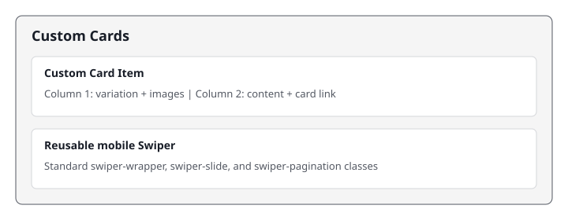

# Custom Cards

The Custom Cards block displays cards with images, badges, and action links. Cards render in a desktop grid and mobile Swiper carousel when within a `.custom-cards-section`.

## Universal Editor — Authoring View

The screenshot below shows the **properties panel** authors see in the Universal Editor when they click to edit this block.



---

## Authoring

The container has no authored fields. Add one or more Custom Card child items.

### Custom Card Item

| Field | Type | Description |
|---|---|---|
| Card Variation | Multi Select | Grouped into column 1; Featured applies the fixed red treatment. |
| Image 1 | Reference | Fixed display artwork for the card. |
| Image 1 Alt Text | Text | Describe the image, or leave empty only when decorative. |
| Image 2 | Reference | Optional legacy image; it is not displayed. |
| Image 2 Alt Text | Text | Describe Image 2 when it conveys information. |
| Title | Text | Card heading. |
| Description | Rich Text | Card supporting copy. |
| Card Link | AEM Content | Destination opened by the circular card action. |
| Card Link Text | Text | Accessible label for the card action link. |

The item renders as two authored columns: variation and images in column 1, then badge, title, description, and card link in column 2.

## Responsive Behaviour

| Breakpoint | Behaviour |
|---|---|
| Mobile (< 600px) | 280 x 260 cards use Swiper with accessible pagination when within `.custom-cards-section`. |
| Desktop (>= 600px) | Cards display in a flexible grid layout. |

## Styling & Variants

### Looking For Plan Cards

In a `looking-for` section, the plan cards retain their icons and text positions
on viewports below 900px. Hover image swaps, text movement, and card effects are
restricted to viewports of at least 900px with a fine, hover-capable pointer.
Mobile cards use a neutral border. The existing infinity intro desktop animation
and authored two-column card structure are unchanged.

Below 900px, tapping the text or artwork of a non-banner plan card activates its
authored red-arrow link. The icon remains the single action target, so its link
destination and click handlers also apply to whole-card taps, including a temporary
`#` destination. Direct link taps fire only once; other interactive controls and
desktop behavior remain unchanged. This behavior is owned by `looking-for.js`.

- **Featured variant**: Apply the `featured` class to a card to display the red treatment (height 382px on desktop).
- **Badge**: Identified automatically as short text (≤ 20 characters) in the body without links.
- **Action**: Identified automatically as any link in the body, displayed as a circular button at bottom-left.

### Best Seller Banner (Section Style)

Apply the **Best Seller Banner** `style` option to the parent **Section** (not the block) to render a Custom
Cards block as a full-bleed swiper banner (badge, heading, subheading + pill CTA over a background image),
matching the Figma "Best Seller - Banner" component. This is independent of the Home page's "Looking For"
style/layout and does not require any other block (e.g. Search) in the section.

Author each Custom Card item as:

| Field | Value |
|---|---|
| Image 1 | Background/environment photo |
| Image 2 | Framed product visual |
| Title | Badge text, e.g. `BEST SELLER` |
| Description | `<h3>Heading</h3><p>Subheading</p><p><a href="...">CTA label</a></p>` |

> Note: this styling is applied via the Section's **Style** field, not the Custom Cards block itself —
> select the section in the Universal Editor to add/remove it.


## File Structure

```text
blocks/custom-cards/
|-- custom-cards.css
|-- custom-cards.js
|-- _custom-cards.json
|-- MAPPING-README.md
|-- README.md
`-- docs/
    `-- ue-authoring.svg
```
